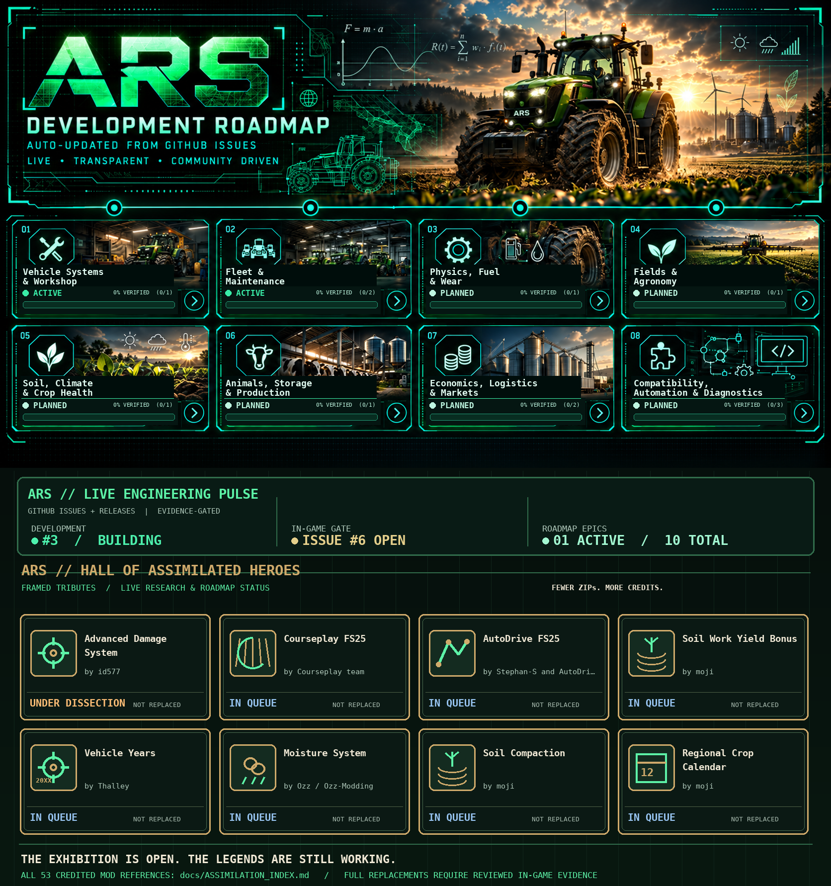

# Advanced Realms Suite (ARS)

### One suite. Connected systems. Real machinery.

**An expanding realism and immersion suite for Farming Simulator 25.**

One automatically refreshed image: cinematic concept art, real public GitHub Issue/Release status and eight framed community tributes. The featured mods are **research inspirations, not claimed as replaced**. Full credits and source links remain visible.

[Live roadmap &amp; acceptance gates](docs/ROADMAP.md) · [All original mods and assimilation statuses](docs/ASSIMILATION_INDEX.md) · [Enter the Hall of Heroes](docs/HALL_OF_HEROES.md) · [Original creators](docs/COMMUNITY_INSPIRATIONS.md)

## The Mission

**More realism. Less mod juggling.**

Great mods can do great things individually. But stacking enough of them can turn a realistic farming setup into a second job: overlapping mechanics, competing vehicle systems and more troubleshooting than tractor driving.

**The tractor should need maintenance. Your mod list shouldn't.**

ARS takes a different approach: **vehicle physics, driving, machinery wear, breakdowns, repairs, fuel and immersive effects — designed as one connected ecosystem**, with systems that complement each other instead of competing for control.

**One cohesive experience. Built to expand.**

### Discover ARS

[**Hall of Assimilated Heroes**](docs/HALL_OF_HEROES.md) · [**Community Inspirations & Thanks**](docs/COMMUNITY_INSPIRATIONS.md) · [**Explore the Wiki**](https://github.com/KeilerHirsch/FS25_Advanced_RealmsSuite/wiki) · [**Connected Systems**](https://github.com/KeilerHirsch/FS25_Advanced_RealmsSuite/wiki/Connected-Systems) · [**Join the Discussion**](https://github.com/KeilerHirsch/FS25_Advanced_RealmsSuite/discussions) · [**Releases**](https://github.com/KeilerHirsch/FS25_Advanced_RealmsSuite/releases)

ARS is an independent community project under active development. Feature availability will expand through tested releases.

---

Not affiliated with or endorsed by GIANTS Software. Project-controlled software is licensed under [EUPL-1.2](LICENSE). [Contributing](CONTRIBUTING.md) · [Security](SECURITY.md) · [Third-party notices](THIRD_PARTY_NOTICES.md) · [Support on Ko-fi](https://ko-fi.com/keilerhirsch)

