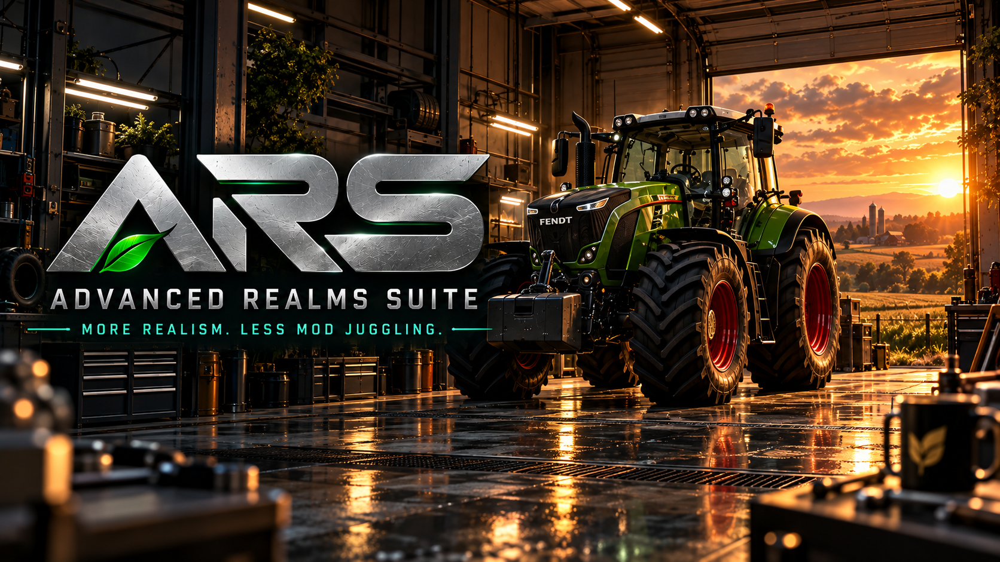
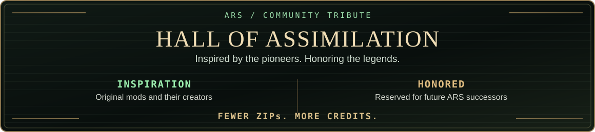

**[English](README.md) · [Deutsch](README.de.md) · [Français](README.fr.md)**

# Advanced Realism Suite (ARS)

**Farming Simulator 25 | PC/Mac**

### More realism. All in one mod.

**One mod. Connected systems. A more realistic farming experience.**

Concept artwork — not an in-game screenshot.

## Live Development

Automatically updated from public GitHub Issues and Releases. [Full roadmap](docs/ROADMAP.md) · [GitHub activity](https://github.com/KeilerHirsch/FS25_Advanced_RealismSuite/issues?q=is%3Aissue+label%3Aroadmap)

## The Mission

Advanced Realism Suite (ARS) is being developed to bring the different aspects of farming realism together in one unified mod for Farming Simulator 25.

Instead of using several separate mods with overlapping mechanics, ARS aims to connect vehicle physics, fuel consumption, dirt, exhaust effects, mechanical wear, damage, diagnostics and workshop repairs.

**What happens in the field should matter in the workshop.**

Heavy loads, demanding terrain and operating hours should influence how machinery behaves, how it wears and what it costs to maintain.

My long-term vision goes further: to gradually connect soil management, crop production, farm economics, livestock, forestry and logistics within the same system.

## Hall of Assimilation

[Enter the Hall](docs/HALL_OF_HEROES.md) · [Original creators](docs/COMMUNITY_INSPIRATIONS.md) · [Hall index](docs/ASSIMILATION_INDEX.md)

## Explore ARS

[Features](docs/FEATURES.md) · [Live Development](#live-development) · [Roadmap](docs/ROADMAP.md) · [Community](https://github.com/KeilerHirsch/FS25_Advanced_RealismSuite/discussions) · [Credits](docs/COMMUNITY_INSPIRATIONS.md)

[Changelog](CHANGELOG.md) · [Wiki](https://github.com/KeilerHirsch/FS25_Advanced_RealismSuite/wiki) · [Releases](https://github.com/KeilerHirsch/FS25_Advanced_RealismSuite/releases)

---

Not affiliated with or endorsed by GIANTS Software. ARS-owned software is licensed under [EUPL-1.2](LICENSE). [Contributing](CONTRIBUTING.md) · [Security](SECURITY.md) · [Third-party notices](THIRD_PARTY_NOTICES.md) · [Support on Ko-fi](https://ko-fi.com/keilerhirsch)

