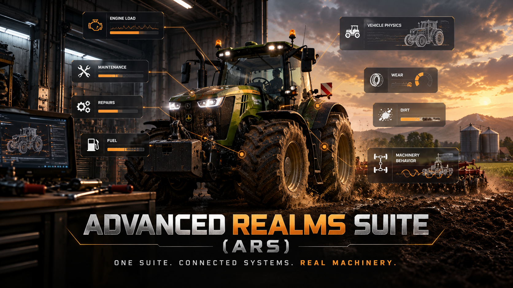

# Advanced Realms Suite (ARS)

### One suite. Connected systems. Real machinery.

**A unified realism and immersion experience for Farming Simulator 25.**

Promotional concept artwork, not an in-game screenshot.

[The idea](#the-idea) · [Connected systems](#connected-systems) · [Built to grow](#built-to-grow) · [Follow ARS](#follow-ars)

## The idea

**Realism should not be a patchwork.**

One mod changes driving. Another handles damage. A third adds maintenance. More mods bring more features, but overlapping vehicle systems can also mean inconsistent behavior, competing calculations and endless compatibility juggling.

**Advanced Realms Suite takes a different approach.**

ARS is being developed as **one integrated realism ecosystem**, where vehicle physics, operating loads, component condition, wear, failures and maintenance are designed to work together from the start.

**Fewer disconnected mechanics. More meaningful interactions. One coherent machinery experience.**

## Connected systems

The ambition is to make what happens to a machine matter throughout its working life:

**Drive & work → Load & stress → Wear & failures → Diagnosis & repairs → Back to work**

| ARS system | What it brings together |
| :--- | :--- |
| **Vehicle physics & driving** | Driving behavior, machinery handling and operating loads |
| **Mechanical condition** | Engine, transmission, hydraulics, cooling and other vehicle components |
| **Wear & breakdowns** | Component degradation, faults and consequences that affect gameplay |
| **Workshop & maintenance** | Diagnostics, service, repairs, costs and machine history |
| **Operational immersion** | Fuel behavior, dirt, exhaust and feedback from real machinery use |
| **Unified game integration** | Connected interfaces, persistent machine state and multiplayer-aware design |

These systems are the **scope and direction of ARS**. Individual features are implemented, tested and expanded over time.

## Built to grow

**One suite does not mean one small feature.**

ARS is designed as an expanding foundation for machinery realism. New capabilities should become part of the same technical ecosystem, share relevant vehicle information and complement existing mechanics rather than compete with them.

The long-term goal is an all-in-one experience that reduces the need to assemble a large collection of partially overlapping realism mods.

That is the ARS philosophy: **integrate, connect, expand.**

## Follow ARS

Development is active, with new gameplay systems and integrations being built and evaluated step by step. The project prioritizes real in-game behavior, understandable technical feedback and stable interactions over inflated feature claims.

[**GitHub Discussions**](https://github.com/KeilerHirsch/FS25_Advanced_RealmsSuite/discussions) · [**Issues & suggestions**](https://github.com/KeilerHirsch/FS25_Advanced_RealmsSuite/issues/new/choose) · [**Releases**](https://github.com/KeilerHirsch/FS25_Advanced_RealmsSuite/releases) · [**Support on Ko-fi**](https://ko-fi.com/keilerhirsch)

---

ARS is an independent community project, not affiliated with or endorsed by GIANTS Software. Project-controlled software is licensed under [EUPL-1.2](LICENSE); third-party resources retain their respective rights. See [Contributing](CONTRIBUTING.md), [Security](SECURITY.md) and [Third-party notices](THIRD_PARTY_NOTICES.md).
