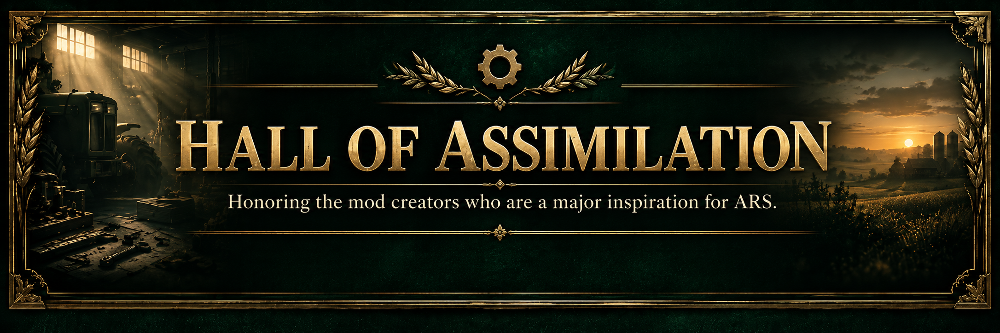

**[Deutsch](README.md) · [English](README.en.md) · [Français](README.fr.md)**

# Advanced Realism Suite (ARS)

**Farming Simulator 25 | PC/Mac**

### Mehr Realismus. Alles in einer Mod.

**Eine Mod. Vernetzte Systeme. Ein realistischeres Landwirtschaftserlebnis.**

Konzeptbild — kein Screenshot aus dem Spiel.

## Live-Entwicklung

Automatisch anhand öffentlicher GitHub-Issues und Releases aktualisiert. [Vollständige Roadmap](docs/ROADMAP.md) · [Aktivitäten auf GitHub](https://github.com/KeilerHirsch/FS25_Advanced_RealismSuite/issues?q=is%3Aissue+label%3Aroadmap)

## Die Mission

Advanced Realism Suite (ARS) wird entwickelt, um verschiedene Aspekte einer realistischen Landwirtschaft in einer einzigen, zusammenhängenden Mod für den Landwirtschafts-Simulator 25 zu vereinen.

Statt mehrere einzelne Mods mit teilweise überschneidenden Funktionen einzusetzen, soll ARS Fahrzeugphysik, Kraftstoffverbrauch, Verschmutzung, Abgaseffekte, mechanischen Verschleiß, Schäden, Diagnose und Werkstattreparaturen miteinander verbinden.

**Was auf dem Feld passiert, soll sich auch in der Werkstatt bemerkbar machen.**

**Das technische Fundament:** ARS setzt auf die nativen Physik- und Fahrzeugsysteme der GIANTS Engine und verbindet deren Signale mit eigenen Realismusfunktionen – statt die Physik neu zu erfinden.

Schwere Lasten, anspruchsvolles Gelände und Betriebsstunden sollen beeinflussen, wie sich Maschinen verhalten, wie sie verschleißen und welche Wartungs- und Reparaturkosten entstehen.

Meine langfristige Vision geht darüber hinaus: Später sollen auch Bodenbearbeitung, Pflanzenbau, Betriebswirtschaft, Tierhaltung, Forstwirtschaft und Logistik miteinander verbunden werden.

## Hall of Assimilation

[Hall besuchen](docs/HALL_OF_HEROES.md) · [Ursprüngliche Mod-Entwickler](docs/COMMUNITY_INSPIRATIONS.md) · [Hall-Übersicht](docs/ASSIMILATION_INDEX.md)

## ARS entdecken

[Funktionen](docs/FEATURES.md) · [Live-Entwicklung](#live-entwicklung) · [Roadmap](docs/ROADMAP.md) · [Community](https://github.com/KeilerHirsch/FS25_Advanced_RealismSuite/discussions) · [Mitwirkende](docs/COMMUNITY_INSPIRATIONS.md)

[Änderungsprotokoll](CHANGELOG.md) · [Wiki](https://github.com/KeilerHirsch/FS25_Advanced_RealismSuite/wiki) · [Veröffentlichungen](https://github.com/KeilerHirsch/FS25_Advanced_RealismSuite/releases)

---

Entwickelt von **KeilerHirsch** für den Landwirtschafts-Simulator 25. Lizenz: [EUPL-1.2](LICENSE). [Mitwirken](CONTRIBUTING.md) · [Sicherheit](SECURITY.md) · [Hinweise zu Drittanbietern](THIRD_PARTY_NOTICES.md) · [Unterstützen auf Ko-fi](https://ko-fi.com/keilerhirsch)

