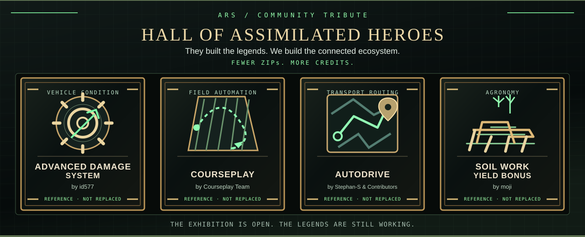

# Hall of Assimilated Heroes 🏛️

> **They built the legends. We build the connected ecosystem.**  
> *Fewer ZIPs. More credits.*



Welcome to the ARS museum of outstanding modding ideas. Farming Simulator's realism community has spent years building clever answers to difficult gameplay problems. **ARS is inspired by that work**, and our goal is to create our **own integrated implementations**, with fewer conflicting systems for players to manage.

We are not pretending we invented vehicle damage, intelligent fieldwork, transport routing, or better agronomy. We are aiming to connect systems that were historically developed separately — and to credit the people who helped the community get there.

**Museum admission policy:** Original creators get their names on the plaques. ARS features get a place in the *Hall of Honor* only after they actually work, pass acceptance tests, and ship. No imaginary retirements.

## Live assimilation display

The single [ARS live hero](../README.md) combines the cinematic roadmap, public
engineering status and the featured pioneer exhibits. Browse **[all credited
mods and their current research status](ASSIMILATION_INDEX.md)** for the
automatically maintained full index. Status labels are derived from public
GitHub roadmap Issues, not guessed code progress or declared replacement.

## Gallery I — The living legends

These are **research and compatibility references**, *not* completed ARS replacements. All original projects remain independent and deserve their own recognition.

### 🖼️ Advanced Damage System

**Original author:** [id577](https://github.com/id577)  
**Original work:** [Advanced Damage System](https://github.com/id577/FS25_AdvancedDamageSystem)  
**What it pioneered for our research:** Multi-component vehicle damage, maintenance, diagnostics and workshop gameplay.  
**ARS interest:** Connected, server-authoritative vehicle condition, failure recovery and paid workshop operations.  
**ARS status:** **Option C in development — NOT replaced.** [See current ARS roadmap](ROADMAP.md).

> *"The machinery broke first. The inspiration survived."*

### 🖼️ Courseplay

**Original creators:** [Courseplay team](https://github.com/Courseplay)  
**Original work:** [Courseplay FS25](https://github.com/Courseplay/Courseplay_FS25)  
**What it pioneered for our research:** Fieldwork planning and automated agricultural operations.  
**ARS interest:** Safe interoperability with existing helper systems now; unified automation is a long-term research topic.  
**ARS status:** **Compatibility/reference — NOT replaced.**

> *"Some legends have covered more hectares than the rest of us."*

### 🖼️ AutoDrive

**Original creators:** [Stephan-S and contributors](https://github.com/Stephan-S/FS25_AutoDrive)  
**Original work:** [AutoDrive FS25](https://github.com/Stephan-S/FS25_AutoDrive)  
**What it pioneered for our research:** Route networks, transport logistics and vehicle automation.  
**ARS interest:** Consistent behavior across helpers, vehicle damage and transport systems.  
**ARS status:** **Compatibility/reference — NOT replaced.**

> *"Every road is a story. Most of them end at a grain silo."*

### 🖼️ Soil Work Yield Bonus

**Original creator:** **moji**  
**Original work:** [Soil Work Yield Bonus — GIANTS ModHub](https://www.farming-simulator.com/mod.php?mod_id=367297)  
**What it pioneered for our research:** Rewarding different soil-working methods with differentiated yield effects.  
**ARS interest:** Soil, agronomy, yield calculation and compatibility with other farming systems.  
**ARS status:** **Research — NOT replaced.**

> *"The plough demanded a raise. The harvest agreed."*

## Gallery II — Hall of Honor

**No officially retired exhibits yet. The legends are still working.** 🚜

A mod earns an **Honored Ancestor** plaque only after the corresponding ARS functionality has:

1. Been independently implemented — **no unlicensed copying of source code or assets**.
2. Passed meaningful **original-only vs. ARS-only** in-game comparison tests, including critical edge cases.
3. Passed **save/reload** and relevant **multiplayer / host-client** tests.
4. Demonstrated that duplicate effects, bills, damage or rewards are not silently applied when systems coexist.
5. Been included in a **published ARS release**, with links to the real acceptance evidence.

A future verified plaque will show the original mod **and author**, what the original did well, the independent ARS successor, a pinned acceptance report and the exact ARS release. We don't award medals for a commit message.

## The assimilation workshop

```text
[ DISCOVER ] --> [ STUDY & TEST ] --> [ REBUILD IN ARS ]
                                           |
                             [ A/B + MP + SAVE VERIFICATION ]
                                           |
                                  [ RELEASED & HONORED ]
```

**Community references stay available.** Their original authorship and licences remain theirs; ARS is neither a fork nor an endorsement by those developers unless stated otherwise. Removing an external ZIP from one tested ARS setup is not the same thing as the original project becoming obsolete for everyone.

For the complete list of credited creators and original links, visit **[Community Inspirations & Thanks](COMMUNITY_INSPIRATIONS.md)**. For what ARS has actually verified and released, see the **[live roadmap](ROADMAP.md)** and **[releases](https://github.com/KeilerHirsch/FS25_Advanced_RealmsSuite/releases)**. For software actually redistributed with ARS, see **[Third-party notices](../THIRD_PARTY_NOTICES.md)**.

*Found a missing credit, a wrong attribution, or an excellent mod we should study? [Tell us in Discussions](https://github.com/KeilerHirsch/FS25_Advanced_RealmsSuite/discussions).*

---

**ARS motto for the museum:** *"Retired from the mod folder. Promoted to legend."*  
**Reality check:** *Retirement papers will be filed only after successful in-game acceptance.* 😎
